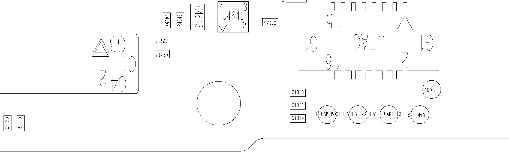

# Test point de arranque USB del Motorola Edge Racer

Fecha de investigación: 15 de octubre de 2026.

**Se encontró documentación específica de Racer que identifica `TP_USB_BOOT`. Su utilidad potencial es forzar una entrada de descarga USB y comprobar si Sahara responde. No se demostró desbloqueo, root ni funcionamiento físico del punto en la unidad investigada.**

## Evidencia documental

Se inspeccionaron visualmente los esquemas NA y WE de Racer/SM7250, revisión V108 del 24 de marzo de 2020, junto con el plano de componentes de la cara inferior. Son documentos con cartela Motorola obtenidos desde un sitio de reparación; su procedencia no equivale a una validación directa del fabricante.

| Referencia | Hallazgo comprobado en los documentos |
| --- | --- |
| Esquema, página 4 | `TP_USB_BOOT` está conectado a `FORCED_USB_BOOT`. Existe un punto independiente `TP_VREG_S4A_1P8` conectado a la alimentación de 1,8 V. |
| Esquema, página 5 | La señal de forzado llega a GPIO48 del procesador por R1028, de 0 ohmios. |
| Esquema, página 3 | Hay un circuito previsto para solicitar descarga con Volumen arriba mediante U1000, un SN74AUC1G240. Está marcado como no montado para producción. |
| Plano inferior | Los puntos USB_BOOT, alimentación de 1,8 V y UART están agrupados junto a la huella JTAG. |

Las páginas 3 y 4 de las variantes NA y WE tienen el mismo texto extraído. Esto no acredita que todas las revisiones de placa fabricadas sean idénticas.

## Ubicación

En la orientación de esta imagen, la fila inferior va de izquierda a derecha: `TP_USB_BOOT`, `TP_VREG_S4A_1P8`, `TP_UART_TX` y `TP_UART_RX`. El punto de tierra está encima del extremo derecho. Esta orientación corresponde al plano inferior; todavía falta compararla con fotografías de la placa concreta.

La imagen es un recorte renderizado del plano original, sin anotaciones añadidas. Los identificadores visibles pertenecen al diseño de la placa y no identifican la unidad del propietario.

## Interpretación eléctrica y límites

La hipótesis mejor respaldada es una activación mediante nivel alto de 1,8 V: el circuito de Volumen arriba utiliza un inversor alimentado a esa tensión para generar la señal de forzado. La [tabla lógica del SN74AUC1G240 publicada por TI](https://www.ti.com/lit/ds/symlink/sn74auc1g240.pdf) confirma la inversión cuando la salida está habilitada.

Es una inferencia del diseño, no una secuencia de servicio validada en este teléfono. No debe sustituirse por el procedimiento genérico de conectar un punto desconocido a tierra. Tampoco se ha establecido el estado de las restricciones de hardware que pudieran afectar a esa entrada. Antes de probarla hay que confirmar la revisión, identificar los pads y verificar las condiciones eléctricas reales, especialmente por la corrosión informada.

La existencia de pads UART o de una huella JTAG tampoco demuestra que esas interfaces estén habilitadas en producción ni que permitan desbloquear el dispositivo.

## Relación con los intentos EDL anteriores

El registro anterior de qboot se detenía esperando HELLO de Sahara, antes de cargar el programador. Windows enumeraba el equipo como Qualcomm 9008. Esto acredita enumeración USB, pero no una sesión de protocolo operativa, y no demuestra rechazo criptográfico del programador.

Un arranque físico controlado permitiría comparar el resultado con la entrada por software. Podría cambiar las condiciones de arranque o temporización; no se ha demostrado que conduzca a un protocolo diferente. Si el saludo continúa sin aparecer, siguen abiertas las hipótesis de transporte, controlador, alimentación y estado del dispositivo.

Incluso con una sesión Sahara válida, el programador debe ser compatible y cumplir la autenticación que aplique. [Aleph documenta esta separación entre entrada EDL, Sahara y programador firmado](https://alephsecurity.com/2018/01/22/qualcomm-edl-1/). [Qualcomm describe por separado la autenticación de imágenes y su vinculación al hardware](https://www.qualcomm.com/content/dam/qcomm-martech/dm-assets/documents/secure-boot-and-image-authentication-version_final.pdf). Ninguno de esos documentos prueba un desbloqueo específico de Racer.

## Siguiente comprobación

1. Comparar fotografías de ambas caras y la revisión serigrafiada con el plano.
2. Confirmar los puntos y la referencia eléctrica antes de cualquier conexión.
3. Evaluar un arranque forzado buscando únicamente un saludo Sahara válido, sin operaciones de escritura al almacenamiento.
4. Si aparece el saludo, evaluar por separado compatibilidad del programador y acceso de lectura. No considerar la mera detección de 9008 como éxito de desbloqueo.

Durante esta investigación documental no se operó el teléfono. El modo físico y la conexión actuales no se verificaron.

## Fuentes y trazabilidad

- [Página que proporciona el paquete de esquemas XT2063](https://tecnicosdecelular.com.br/blog/esquema-eletrico-moto-edge-xt2063/).
- [Archivo consultado](https://tecnicosdecelular.com.br/wp-content/uploads/2022/10/Moto-Edge-XT2063.rar), 78.395.772 bytes. Los documentos completos no se incorporan a esta actualización.
- Esquemas examinados: `SCHEMATICS_ XT2063_ racer_MB_sm7250_PVT_NA_schematics_V108_0324.pdf` y la variante `WE`; páginas 3, 4 y 5.
- Plano examinado: `COMPONENT LOCATION_ XT2063_Component location MB_Bottom.pdf`, una página.
- [Manifiesto de esta evidencia](../evidence/testpoint-research-2026-10-15.json): hashes del archivo fuente, documentos y recorte publicado.
